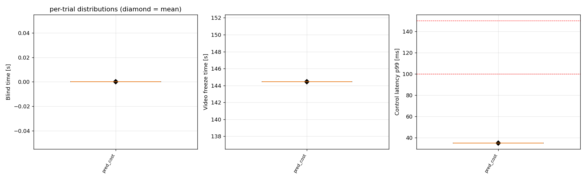
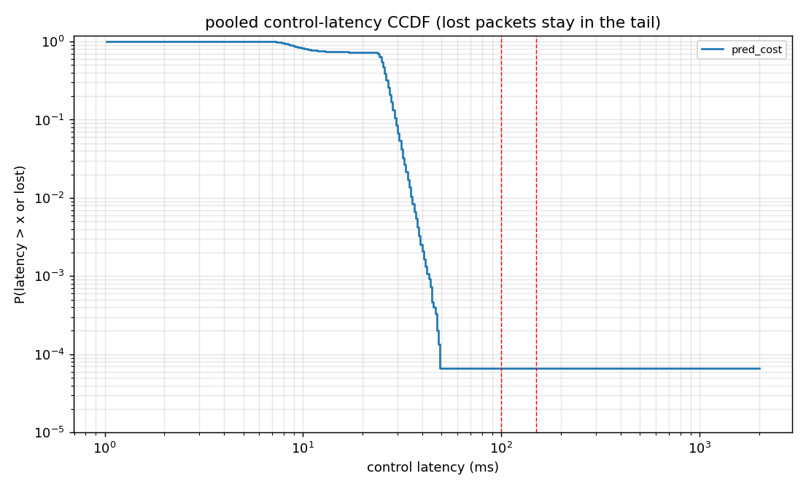
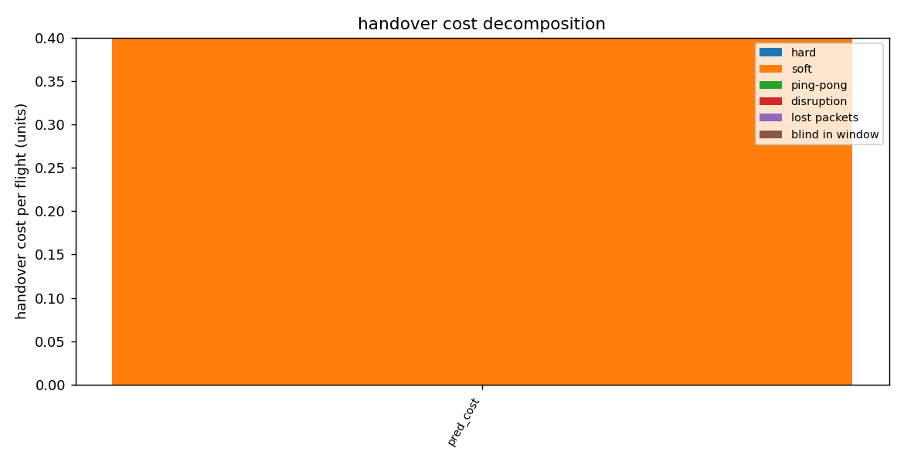
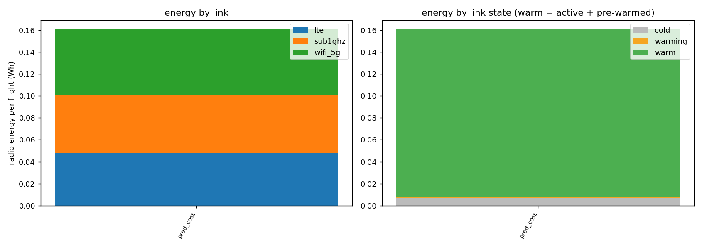
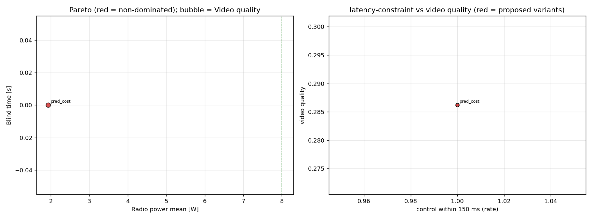
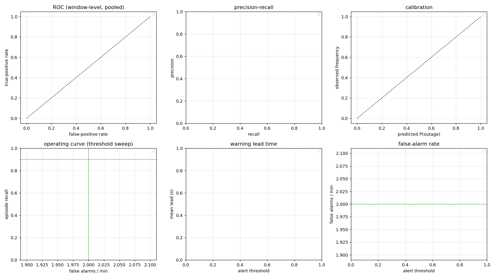
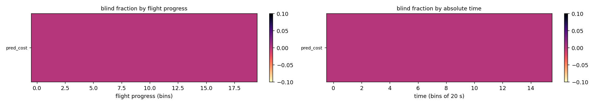
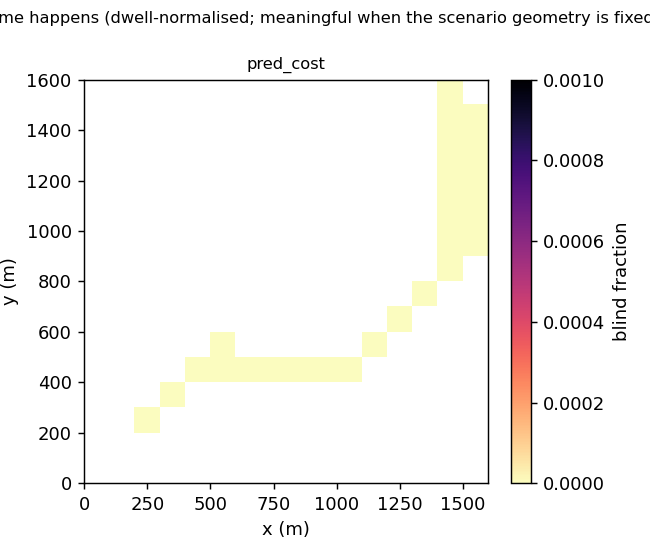

# Multi-link UAV handover - evaluation report

*Source*: `/home/sandaru-gaurange/Downloads/UAV/results/uavlink-ui/20261025-123956-e101e5` | runs: 1 over 1 policies | tiers: {'ticks': 1} | config hash `3e6b5481d258a991` | evaluator v1.0.0

## Definitions in force

- **Control reliable**: on-time (<= 150 ms) ratio >= 0.8 over 0.3 s AND no gap > 200 ms.
- **Video usable**: decodable ratio >= 0.7 over 0.5 s. Freeze = stall >= 0.2 s.
- **Blind time**: airborne time with control NOT reliable AND video NOT usable (mode `recompute`).
- Latency limits reported: [100.0, 150.0]. Statistics: alpha=0.05, holm correction, primary test wilcoxon, paired by trial.

## Caveats detected automatically

- 1 runs did not complete the mission (failsafe landing, battery, timeout). Absolute blind time is censored by shorter flights; read blind_fraction / blind_per_min alongside it.
- Blind time is zero-inflated for: pred_cost. Means can be dominated by few runs; rank-based tests, the P(any blind) McNemar test and medians are reported too.

## 1. Headline results

Mean per policy with bootstrap CI over trials.

| policy | n | blind s | P(any blind) | longest blind s | ctrl<=100ms | ctrl<=150ms | ctrl p99 ms | video Q | freeze s | J cost | done |
|---|---|---|---|---|---|---|---|---|---|---|---|
| pred_cost | 1 | 0 [-, -] | 0 | 0 | 0.9999 | 0.9999 | 35.1 [-, -] | 0.286 [-, -] | 144 [-, -] | 0.786 [-, -] | 0 |

## 3. Goal scorecard (configurable targets)

PASS only if the CI clears the target; INCONCLUSIVE = point estimate and CI straddle it.

| goal | policy | vs | estimate | 95% CI | target | verdict |
|---|---|---|---|---|---|---|
| Control p99 latency <= 150 ms | pred_cost |  | - | [-, -] | 150 | NO DATA |
| Control within 150 ms >= 99 % | pred_cost |  | - | [-, -] | 0.99 | NO DATA |
| Mean comm power <= 8 W budget | pred_cost |  | - | [-, -] | 8 | NO DATA |
| Outage-prediction AUC >= 0.90 | pred_cost |  | - | [-, -] | 0.9 | NO DATA |
| Outage episode recall >= 0.90 | pred_cost |  | - | [-, -] | 0.9 | NO DATA |
| Mean warning lead time >= 1.0 s | pred_cost |  | - | [-, -] | 1 | NO DATA |
| False alarms <= 2 per minute | pred_cost |  | - | [-, -] | 2 | NO DATA |
| Brier score <= 0.10 | pred_cost |  | - | [-, -] | 0.1 | NO DATA |

## 4. Control latency distribution

Per-run percentiles (mean [CI] over runs) and pooled percentiles from the packet histogram (lost packets count as +inf).

| policy | p50 ms | p95 ms | p99 ms | p99.9 ms | pooled p50 | pooled p95 | pooled p99 | pooled p99.9 | lost rate | mean longest gap ms |
|---|---|---|---|---|---|---|---|---|---|---|
| pred_cost | - | 30.8 [-, -] | 35.1 [-, -] | 42.2 [-, -] | 25.1 | 30.9 | 35.3 | 42.6 | - | - |

## 5. Video quality and freezes

| policy | quality | usable fraction | decodable | freeze s | freezes | longest freeze s | delivered Mbps |
|---|---|---|---|---|---|---|---|
| pred_cost | 0.286 [-, -] | 0.517 | - | 144 [-, -] | - | - | - |

## 6. Handover count and cost

Cost model weights: {"hard": 1.0, "soft": 0.2, "pingpong": 2.0, "disruption_per_s": 1.0, "lost_packet": 0.005, "blind_per_s": 2.0, "window_s": 2.0, "pingpong_s": 3.0}

| policy | hard | soft | ping-pong | switch/min | cost [CI] | disruption s | proactive share | hard time-to-usable s | RLF | dup time s |
|---|---|---|---|---|---|---|---|---|---|---|
| pred_cost | 0 | 2 | 0 | - | 0.4 [-, -] | - | 1 | - | - | - |

## 7. Radio energy, power and spectrum

| policy | radio Wh [CI] | mean W | p99 W | over power budget s | spectrum MHz | over spectrum s | J / delivered Mbit | % of battery |
|---|---|---|---|---|---|---|---|---|
| pred_cost | 0.161 [-, -] | 1.93 | - | - | 8.32 | - | 1.24 | - |

## 8. Outage prediction quality

Horizon 3 s, threshold 0.5, label mode onset.

| policy | AUC | AP | Brier | ECE | episode recall | precision | lead s | false alarms/min | outages acted on | primary outages/run | outage->blind |
|---|---|---|---|---|---|---|---|---|---|---|---|
| pred_cost | - | - | 0.00209 | 0.0155 | - | 0 | - | 0.4 | - | 0 | - |

